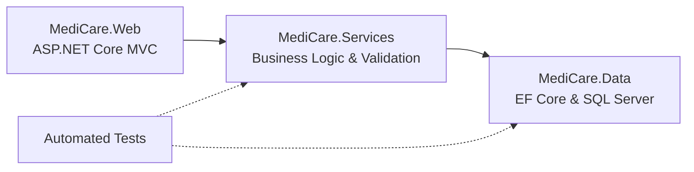

# MediCare — Clinic Management & Appointment System


## Quick Navigation

[Overview](#project-overview) · [Tech Stack](#technical-stack) · [Architecture](#architecture-at-a-glance) · [Features](#implementation-status-across-sprints) · [Local Setup](#local-development--setup-guide) · [Testing](#6-run-automated-tests) · [Documentation](#repository--documentation-structure)


## Documentation Shortcuts

- [Technical Documentation](docs/06-final/technical-documentation.md) — architecture and implementation reference.
- [User Manual](docs/06-final/user-manual.md) — user-facing workflows and instructions.
- [Project Presentation](docs/06-final/project-presentation.md) — concise project overview.
- [Full Documentation Directory](docs/) — planning, requirements, design, testing, and final deliverables.

---

## Project Overview
**MediCare** is a clinic management and appointment system developed for the **Digital Egypt Pioneers Initiative (DEPI) .NET Full Stack track**. It brings doctor discovery, appointment scheduling, clinical records, prescriptions, and clinic administration into one ASP.NET Core MVC application.

The system streamlines Egyptian outpatient clinic operations by offering dynamic, conflict-free appointment scheduling with SQL Server concurrency protection, role-based portals for patients, clinicians, clinic administrators, and licensed pharmacists, real-time push notifications, digital prescription issuance with standardized print views, offline-safe server-side QR verification, clinical history and allergy tracking, automated 24-hour background reminders, and multi-format administrative analytics.

---

## Technical Stack
- **Framework & Runtime:** ASP.NET Core MVC (.NET 8 LTS, C# 12)
- **Data Access & ORM:** Entity Framework Core 8, Microsoft SQL Server 2022 / LocalDB
- **Authentication & Security:** ASP.NET Core Identity 8, Role-Based Access Control, Anti-CSRF (`[ValidateAntiForgeryToken]`), Per-IP Rate Limiting, BOLA/IDOR Defense, CSV Formula Injection Mitigation (CWE-1236), OWASP Security Headers & CSP Report-Only
- **Payment Processing:** Electronic payment checkout simulation (Luhn-algorithm card validation, expiry verification, promotional discounts `DEPI2026` / `MEDICARE50`) without third-party payment gateway integration.
- **Digital Prescriptions & Pharmacy:** Server-side QR Code Generation (`QRCoder`), Optimistic Concurrency Tokens (`WHERE IsDispensed = 0`), Dedicated Pharmacist Portal
- **Real-Time Communication:** ASP.NET Core SignalR (Strongly-Typed Hubs)
- **Background Processing:** Hosted Background Services (`BackgroundService`, `IServiceScopeFactory`)
- **Email & Messaging:** MailKit (SMTP via `IEmailService`), SendGrid adapter, Twilio SMS adapter, Mock SMS (`ISmsService`)
- **AI Clinic Guide & Medical Safety Architecture:** Flexible `IAiAssistantService` abstraction supporting OpenAI (Responses API) and Azure OpenAI with server-side emergency pre-emption (Egyptian Ambulance 123 for chest pain, dyspnea, stroke), medication prescription refusal, Egyptian PII detection and redaction (National ID `[REDACTED_NATIONAL_ID]`, phone numbers `[REDACTED_PHONE]`), explicit opt-in consent gating (unchecked by default), strict JSON output parsing, and deterministic local rule-based fallback when unconfigured or offline. Zero raw medical text is logged.
- **Frontend & UI:** Bootstrap 5, FullCalendar 6, Chart.js, Leaflet, Bootstrap Icons, Self-Hosted Assets (`wwwroot/lib/`), CSS Print Media Queries
- **Validation & Testing:** FluentValidation, xUnit, Moq, FluentAssertions, SQL Server LocalDB Concurrency Integration Tests
- **Reporting:** Multi-format exports (Sanitized CSV, Native OpenXML `.xlsx` Excel, Standard PDF)
- **CI/CD & Hosting:** GitHub Actions workflow for Azure App Service and Azure SQL Database (deployment requires a configured Azure resource and publish-profile secret; no live application URL is currently verified)

---

## Architecture at a Glance

MediCare separates the MVC presentation layer, application services, and data access into three projects. Controllers call service contracts rather than accessing the database directly.




## Implementation Status across Sprints

### Sprint 1: Foundation Phase
| Component | Status | Architectural Notes |
|---|:---:|---|
| **Solution Architecture** | &#10003; Complete | 3-Project N-Tier (`MediCare.Web` -> `MediCare.Services` -> `MediCare.Data`). Controllers inject services only. |
| **Data Entities & Schema** | &#10003; Complete | 11 domain entities + Identity. Automatic `CreatedAt`/`UpdatedAt` audit timestamps. No soft delete. |
| **Concurrency Safeguards** | Implemented | A SQL Server filtered unique index prevents duplicate doctor/time bookings unless an earlier appointment was cancelled or rejected. |
| **Database Migrations** | &#10003; Complete | Applied `InitialCreate` and `FinalGapClosureSchema` on SQL Server LocalDB (`(localdb)\mssqllocaldb`). |
| **Identity & Authentication** | &#10003; Complete | Roles (`Admin`, `Doctor`, `Patient`). Patient registration active immediately; Doctor registration requires approval (`IsApproved = false`). |
| **Database Seeder** | &#10003; Complete | `DbInitializer` seeds 1 Admin, 5 Specializations, 5 Doctors across Egyptian governorates with working hours, 5 Patients, past clinical encounters, prescriptions, and upcoming visits. |
| **Doctor Directory** | &#10003; Complete | Public list with search, governorate filtering, specialization, max fee, available day filters, pagination, and detailed doctor schedule profiles. |

### Sprint 2: Booking Engine Phase
| Component | Status | Architectural Notes |
|---|:---:|---|
| **Doctor Schedule Management** | &#10003; Complete | Doctor portal for weekly `WorkingHours` and `DoctorLeaves` with conflict detection warning if active appointments exist. |
| **Slot Calculation Engine** | &#10003; Complete | Pure, deterministic slot calculation engine in `MediCare.Services`. Excludes leaves, existing bookings, enforces 2h lead time, 30d advance booking window, and clinic local time (`Africa/Cairo`). |
| **Interactive Booking Flow** | &#10003; Complete | FullCalendar 6.1 interactive UI, slot selection modal, `AppointmentFactory`, booking review, and conflict pre-checking via `/api/appointments/check-conflict`. |
| **State Machine & Lifecycle** | &#10003; Complete | Full lifecycle transitions (`Pending` -> `Confirmed`/`Rejected`, `Cancelled` with 2h rule, `Completed`, `NoShow`) with ownership enforcement (403 IDOR prevention). |
| **Real-Time Push Notifications** | &#10003; Complete | Strongly-typed SignalR `AppointmentHub` (`IAppointmentNotificationClient`), persist-to-DB first architecture, unread counter badge, bell dropdown, and live toast popups. |

### Sprint 3: Clinical Encounters, Prescriptions & Admin Analytics
| Component | Status | Architectural Notes |
|---|:---:|---|
| **Clinical Encounter Documentation** | Implemented | Doctor encounter form with diagnosis, symptoms, visit notes, and diagnostic file upload (JPG/PNG/PDF, up to 5 MB). Files are stored under `App_Data/uploads/records/` with generated names. |
| **Completion Rule** | Implemented | A doctor can document an encounter for a confirmed appointment after its scheduled start time; the appointment and clinical record are saved together. |
| **Itemized Digital Prescriptions** | &#10003; Complete | Prescriptions linked to encounter, doctor, and patient with dynamic multi-medication repeater (Medication, Dosage, Frequency, Duration Days, Instructions). |
| **Standardized Print View** | &#10003; Complete | Dedicated `/Prescriptions/Print/{id}` view with `@media print` CSS rules, clinic branding, doctor license metadata, patient age calculation, Rx body, and physician signature block. |
| **Admin Doctor Approvals** | &#10003; Complete | Admin portal (`/Admin/Approvals`) to review credentials, approve doctors (`IsApproved = true`), or decline with explanatory note; transactional emails sent via MailKit. |
| **Admin Dashboard & Analytics** | &#10003; Complete | Operational metrics ribbon (Total Visits, Active/Pending Doctors, Completed Rate, Paid Revenue, Pending Revenue), Chart.js monthly volume bar chart, and specializations distribution doughnut chart. |
| **RFC 4180 CSV Export** | &#10003; Complete | Full appointments CSV export (`/Admin/ExportAppointmentsCsv`) with UTF-8 BOM preamble for Excel compatibility and CSV Formula Injection mitigation (CWE-1236). |

### Sprint 4: Final Gap Closure & Compliance Hardening
| Component | Status | Architectural Notes |
|---|:---:|---|
| **Patient Profile & Allergies** | &#10003; Complete | Patient portal (`/Account/Profile`) to manage personal information, emergency contacts, recorded drug allergies, and chronic medical history with FluentValidation. |
| **Governorates Location Filter** | &#10003; Complete | Server-side bidirectional English/Arabic governorate filtering in `IDoctorRepository` across all 27 Egyptian governorates. |
| **Atomic Rescheduling** | &#10003; Complete | Atomic self-service appointment rescheduling (`/Appointments/Reschedule/{id}`) enforcing 2-hour lead time, working hours, doctor leaves, patient conflict checks, and DB index isolation. |
| **Admin Patient Management** | &#10003; Complete | Admin patient directory (`/Admin/Patients`) with multi-field search and instant account lockout/unlock management. |
| **Specializations CRUD** | &#10003; Complete | Clinical departments directory (`/Admin/Specializations`) with create, edit, and delete actions guarded against deleting active doctor specialties. |
| **Executive Analytics & Cohorts** | &#10003; Complete | Top 5 performing clinicians league table and patient demographic cohorts (`<18`, `18-35`, `36-50`, `50+`) on Admin dashboard and reports views. |
| **Multi-Format Export Subsystem** | &#10003; Complete | Native Microsoft Excel OpenXML (`.xlsx`) and branded PDF report generation alongside sanitized CSV exports. |
| **24-Hour Reminder Background Worker** | &#10003; Complete | Hosted `AppointmentReminderBackgroundService` scanning confirmed appointments in `[Now + 23h, Now + 25h]`, dispatching Email, SMS, and in-app SignalR alerts with `ReminderSent` flag tracking. |
| **Automated Tests** | &#10003; 527 Passed | Comprehensive test suite (unit, services, security, controllers, mock AI HTTP handlers, and SQL Server integration tests) in `tests/MediCare.Tests` passing 100% (527 passed, 0 failed, 0 skipped across Debug and Release builds). |

---

## Local Development & Setup Guide

### 1. Prerequisites
- **.NET 8 SDK (LTS)**: Check version using `dotnet --version`
- **SQL Server**: Microsoft SQL Server 2022 or SQL Server Express / LocalDB (`MSSQLLocalDB`)
- **Git**

### 2. Clone and Checkout
```bash
git clone https://github.com/foxelhadad812-design/MediCare.git
cd MediCare
```

### 3. Environment & Secrets Configuration

MediCare differentiates security posture across runtime environments via standard `ASPNETCORE_ENVIRONMENT` (`Development` vs `Production`).

#### Environment Differentiators:
- **Development Mode (`ASPNETCORE_ENVIRONMENT=Development`):**
  - Cookie security allows `CookieSecurePolicy.SameAsRequest` to facilitate local development over HTTP without cookie drops.
  - Test Pharmacist account (`pharmacist@medicare.com`) is optionally seeded only if `Seed:PharmacistPassword` is provided in user-secrets.
  - Demo accounts are seeded only in Development. Set `Seed:DefaultPassword` in user-secrets before initializing a fresh local database; the application no longer uses a built-in demo password.
- **Production Mode (`ASPNETCORE_ENVIRONMENT=Production`):**
  - Cookies enforce `CookieSecurePolicy.Always` with `Secure`, `HttpOnly`, and `SameSite=Strict/Lax`.
  - Administrator password **must** be provided via environment variable or Azure Key Vault and **strictly enforced to be at least 16 characters long**. Startup fails immediately if missing or weak.
  - Seeding of demo doctors, patients, mock appointments, and the Pharmacist account is **completely disabled**. Zero mock clinical data is generated. Pharmacist and doctor accounts must be provisioned individually through the Admin Panel.
  - HTTP Strict Transport Security (HSTS) is enforced (365 days, preload, subdomains).

#### Managing Secrets via `dotnet user-secrets` (Development):
To ensure zero credentials are committed to source control, configure secrets locally:
```bash
cd src/MediCare.Web
dotnet user-secrets init

# Local database connection string (LocalDB):
dotnet user-secrets set "ConnectionStrings:DefaultConnection" "Server=(localdb)\mssqllocaldb;Database=MediCareDb;Trusted_Connection=True;MultipleActiveResultSets=true;TrustServerCertificate=True"

# Configure seeded account passwords:
dotnet user-secrets set "Seed:AdminPassword" "<YourStrongAdminPassword16CharsMin!>"
dotnet user-secrets set "Seed:PharmacistPassword" "<YourStrongPharmacistPassword!>"
dotnet user-secrets set "Seed:DefaultPassword" "<YourSecureDefaultPassword>"

# Optional AI Clinic Assistant (OpenAI or Azure OpenAI)
# Option A: Standard OpenAI
dotnet user-secrets set "AiAssistant:Provider" "OpenAI"
dotnet user-secrets set "AiAssistant:ApiKey" "<YourOpenAIProjectApiKey>"
dotnet user-secrets set "AiAssistant:Model" "gpt-4o-mini"
dotnet user-secrets set "AiAssistant:TimeoutSeconds" "15"

# Option B: Azure OpenAI
# dotnet user-secrets set "AiAssistant:Provider" "AzureOpenAI"
# dotnet user-secrets set "AiAssistant:ApiKey" "<YourAzureOpenAIApiKey>"
# dotnet user-secrets set "AiAssistant:Endpoint" "https://<your-resource-name>.openai.azure.com"
# dotnet user-secrets set "AiAssistant:Model" "<your-deployment-name>"
# dotnet user-secrets set "AiAssistant:TimeoutSeconds" "15"

# Optional: Configure trusted reverse proxy IPs (if running behind IIS, Nginx, or Azure Application Gateway):
dotnet user-secrets set "ForwardedHeaders:KnownProxies:0" "127.0.0.1"
```

#### Production Environment Variables:
In containerized or cloud environments (Azure App Service / Docker / Linux), configure via environment variables:
```bash
ConnectionStrings__DefaultConnection="Server=...;Database=...;"
Seed__AdminPassword="<StrongEnterpriseAdminPasswordAtLeast16Chars>"
ForwardedHeaders__KnownProxies__0="<ReverseProxyInternalIP>"

# AI Assistant Configuration (OpenAI or Azure OpenAI):
AiAssistant__Provider="OpenAI"
AiAssistant__ApiKey="<OpenAIProjectApiKey>"
AiAssistant__Model="gpt-4o-mini"
AiAssistant__TimeoutSeconds="15"

# For Azure OpenAI, provide Endpoint and deployment name:
# AiAssistant__Provider="AzureOpenAI"
# AiAssistant__ApiKey="<AzureOpenAIApiKey>"
# AiAssistant__Endpoint="https://<resource>.openai.azure.com"
# AiAssistant__Model="<deployment-name>"
```

> [!NOTE]
> **AI Safety, Privacy & Fallback Guarantees:**
> - **Zero Commits of Secrets:** Never commit API keys or credentials to version control. Keys are injected exclusively via user-secrets or environment variables (`AiAssistant:ApiKey`, `OPENAI_API_KEY`, or `AZURE_OPENAI_API_KEY`).
> - **Explicit Consent Gate:** The user must explicitly tick the consent checkbox (`ConsentGiven`) before any prompt is processed. If unconsented, **zero external HTTP requests** are made and the system returns a consent requirement warning.
> - **Server-Side Medical Safety Interceptors:** Critical life-threatening emergencies (e.g., severe chest pain, shortness of breath, suspected stroke) are intercepted immediately by `MedicalSafetyGuard` and redirected to the **Egyptian Ambulance Service (123)** without calling external AI providers. Medication prescriptions are strictly refused.
> - **Egyptian PII Detection & Redaction:** Prompts are scrubbed of Egyptian National IDs (14 digits) and phone numbers (`010/011/012/015`) into `[REDACTED_NATIONAL_ID]` and `[REDACTED_PHONE]` by `PatientDataPrivacyGuard` before transmission.
> - **Ephemeral Transmission & Zero Raw Health Logging:** External API requests enforce `store: false`. Raw clinical text is never logged to application logs.
> - **Local Offline Fallback (Demo Mode):** If no API key is configured or the external service is unreachable, the system automatically falls back to deterministic local keyword analysis and tags the response with an explicit badge (`وضع تجريبي محلي`).

---

### 4. Apply Database Migrations
Run the EF Core database update from the repository root:
```bash
dotnet ef database update --project src/MediCare.Data --startup-project src/MediCare.Web
```

> [!NOTE]
> **Legacy Data & Payment Backfill Note:**
> Payment details for appointments marked as `Paid` prior to migration `20261009210023_AddAppointmentPaymentDetailsAndBackfill` are backfilled on a best-effort basis (extracted from historical 'Payment Received' in-app notifications where available, or deterministically populated with the appointment's original consultation fee, zero discount, and UTC audit timestamps).

---

### 5. Run the Application
```bash
dotnet run --project src/MediCare.Web
```
Open your browser at `https://localhost:7050` or `http://localhost:5066`, as configured by the HTTPS launch profile. On a fresh Development database, the initializer creates sample data. Configure the required demo-account password first.

#### Emergency CLI Account Recovery Command:
If an administrator or staff account requires an immediate lockout reset directly on the server console (without web UI access):
```bash
dotnet run --project src/MediCare.Web -- --recovery-unlock-user admin@medicare.com
```
This utility resets failed access attempts, clears the lockout timestamp, and exits immediately before starting the web server.

---

### 6. Run Automated Tests

Execute the automated test suites (545 tests across unit, calculation engine, DST timezone, clinical encounter, admin metrics, security, and SQL Server integration test suites):

```bash
# Run the entire test suite (including SQL Server LocalDB integration tests)
dotnet test MediCare.sln

# Run unit tests only (isolated in-memory and mock tests)
dotnet test MediCare.sln --filter "Category!=Integration"

# Run SQL Server filtered unique index and concurrency integration tests
dotnet test MediCare.sln --filter "Category=Integration"
```

> **Note on Integration Tests:** The integration tests verify the filtered unique index concurrency guarantees and optimistic concurrency token (`WHERE IsDispensed = 0`) against Microsoft SQL Server LocalDB (`(localdb)\mssqllocaldb;Database=MediCare_IntegrationTests`) or the container configured via `MEDICARE_TEST_CONNECTION_STRING`.

---

## System Roles & Access Control

| Role | Core Responsibilities & Capabilities | Lockout Policy |
|---|---|---|
| **Admin** | Clinic administration, doctor approval workflows, patient status & lockout toggles, pharmacist account creation, executive analytics, and RFC 4180 / Excel / PDF exports. | **Exempt from account lockout** to eliminate Denial of Service (DoS) risks; protected via IP-based rate limiting (5 req/min) and failed login audit warnings. |
| **Doctor** | Schedule & working hours management, leaves calendar, appointment confirmations/rejections, digital encounter charting, itemized digital prescriptions with QR code. | Standard lockout (5 failed attempts locks for 15 minutes). Admin or CLI can unlock. |
| **Patient** | Doctor search by specialty and 27 governorates, interactive booking calendar, atomic rescheduling, medical history/allergy profile, digital prescription view & download. | Standard lockout (5 failed attempts locks for 15 minutes). Admin or CLI can unlock. |
| **Pharmacist** | Verification and atomic dispensing of digital prescriptions via token scanning (`/Prescriptions/Verify`, `/Prescriptions/Dispense`). | Standard lockout (5 failed attempts locks for 15 minutes). Admin or CLI can unlock. |

---

## Pre-Seeded Demo Accounts

Passwords for development demo accounts come from user-secrets or environment configuration. Use fictional/sample patient and doctor data only in local demonstrations. Production administrator provisioning requires a configured strong password.

| Account Role | Email Address | Display Name / Clinical Specialty | Provisioning Behavior |
|---|---|---|---|
| **Administrator** | `admin@medicare.com` | System Administrator | Seeded on first boot. Requires a configured password in Production. |
| **Pharmacist** | `pharmacist@medicare.com` | Licensed Pharmacist | Seeded in Development only if secret configured. Must be created in Admin Panel in Production. |
| **Doctor** | `ahmed.mahmoud@medicare.com` | Dr. Ahmed Mahmoud (Cardiology) | Development sample account with a demo clinic schedule. |
| **Doctor** | `sara.alsayed@medicare.com` | Dr. Sara Al-Sayed (Dermatology) | Seeded with demo clinic schedule across Giza. |
| **Doctor** | `youssef.nabil@medicare.com` | Dr. Youssef Nabil (Pediatrics) | Seeded with demo clinic schedule across Alexandria. |
| **Doctor** | `mona.mansour@medicare.com` | Dr. Mona Mansour (Orthopedics) | Seeded with demo clinic schedule. |
| **Doctor** | `tarek.ezzat@medicare.com` | Dr. Tarek Ezzat (General Internal Medicine) | Seeded with demo clinic schedule. |
| **Patient** | `khaled.omar@medicare.com` | Khaled Omar | Pre-seeded with encounter & prescription history. |
| **Patient** | `nourhan.ali@medicare.com` | Nourhan Ali | Pre-seeded with upcoming appointment. |
| **Patient** | `mostafa.hassan@medicare.com` | Mostafa Hassan | Pre-seeded patient record. |
| **Patient** | `dina.fathy@medicare.com` | Dina Fathy | Pre-seeded patient record. |
| **Patient** | `mohamed.selim@medicare.com` | Mohamed Selim | Pre-seeded patient record. |

---

## Security Architecture & Engineering Trade-offs

1. **Admin Lockout Exemption vs IP Rate Limiting:**
   - *Rationale:* Enabling Identity account lockout on the sole clinic Administrator exposes the clinic to a trivial Denial-of-Service (DoS) attack where any anonymous attacker could lock the administrator out by submitting 5 wrong passwords.
   - *Defense-in-Depth:* Instead of account-level lockout, the login endpoint enforces a per-IP Fixed Window Rate Limiter (maximum 5 POST attempts per minute per IP). In addition, every failed administrator login triggers a high-severity `SECURITY ALERT` warning log (without logging passwords). In case of an emergency, the CLI switch `--recovery-unlock-user` can restore access on the host.

2. **Self-Hosted Vendor Assets & Data Privacy:**
   - *Privacy Protection:* To avoid sending patient health data or prescription verification tokens to third-party endpoints, routine application assets are self-hosted and sensitive records stay in the configured application storage. The optional clinic guide is the exception: if configured, it sends only the submitted chat message to OpenAI, with `store: false`; the UI warns users to use fictional data only.
     - Digital prescription QR codes are generated 100% server-side via `QRCoder` as inline PNG Data URIs (removing `api.qrserver.com`).
     - Chatbot avatar badges render locally generated SVG/HTML initials badges (removing `ui-avatars.com`).
     - Frontend vendor libraries (SignalR 8.0.7, Chart.js 4.4.1, FullCalendar 6.1.15, Leaflet 1.9.4 with local marker icons, Canvas Confetti 1.9.3, Bootstrap Icons 1.11.3) are self-hosted in `wwwroot/lib/`.
     - Typography fonts (Cairo & Inter) are self-hosted in `wwwroot/lib/fonts/` (removing `fonts.googleapis.com` and `fonts.gstatic.com`).
   - *External Network Boundaries:* External calls include map tiles (`*.tile.openstreetmap.org`), optional telemedicine rooms (`meet.jit.si`), optional OpenAI Responses API chat generation, and the user-initiated WhatsApp link below. The privacy page identifies these boundaries.
   - *Optional User-Initiated WhatsApp Reminders:* Appointment details include an optional, user-initiated WhatsApp button (`api.whatsapp.com/send?phone=...`) for patient appointment confirmation. This button opens WhatsApp in a new tab protected with `rel="noopener noreferrer"`. It is entirely client-side, optional, and never transmits clinical records or diagnoses.

3. **Content-Security-Policy (CSP) in Report-Only Mode:**
   - *Policy:* `Content-Security-Policy-Report-Only` and `Permissions-Policy` headers are emitted on every HTTP response.
   - *Trade-off:* Because legacy Razor views contain server-rendered inline JavaScript for dynamic calendar, chart, and modal event bindings, CSP is kept in Report-Only mode during auditing to avoid breaking frontend interactive charts without requiring complete nonce injection or bundle refactoring.

4. **Atomic Concurrency in Prescription Dispensing:**
   - *Protection:* To prevent race conditions and double-dispensing in busy pharmacy settings, `Prescription` employs an optimistic concurrency token (`[ConcurrencyCheck] public bool IsDispensed`).
   - *Database Invariant:* Dispensing queries issue an atomic `UPDATE ... SET IsDispensed = 1 WHERE Id = @id AND IsDispensed = 0`. SQL-backed concurrency tests are maintained in the suite; they require SQL Server LocalDB or `MEDICARE_TEST_CONNECTION_STRING`. See the dated test report for the most recent verification status.

5. **Mandatory Staff Password Change Enforcement:**
   - *Security Requirement:* When the clinic Administrator creates a staff account (such as a licensed pharmacist), the account is created with a temporary password and assigned the `MustChangePassword` claim.
   - *Enforcement Mechanism:* `MustChangePasswordMiddleware` intercepts authenticated requests across the application. Any staff user holding the `MustChangePassword` claim is strictly redirected to `/Account/ChangePassword` before accessing any clinical records, appointments, or prescriptions. Upon successful password update, the claim is removed and the user's security cookie is refreshed.

---

## Production Deployment Readiness Checklist

| Category | Component / Check | Status | Verification & Operational Rule |
|---|---|:---:|---|
| **Build & Compilation** | Multi-Stage Dockerfile | &#10003; Ready | Multi-stage build targeting `mcr.microsoft.com/dotnet/sdk:8.0` and `aspnet:8.0`. Exposes port 8080. |
| **Health Monitoring** | `/health` Endpoint | &#10003; Ready | Configured in `Program.cs` (`app.MapHealthChecks("/health")`). Responds HTTP 200 `Healthy` for load balancers. |
| **Environment Mode** | `ASPNETCORE_ENVIRONMENT` | &#10003; Ready | Production mode enforces strict HSTS (365 days), `CookieSecurePolicy.Always`, and disables demo clinical seeder. |
| **Admin Provisioning** | `Seed:AdminPassword` | &#10003; Enforced | Must be provided via environment variable or Key Vault with >= 16 characters. Startup aborts immediately if missing. |
| **Database Target** | `ConnectionStrings:DefaultConnection` | &#10003; Ready | Production SQL Server or Azure SQL connection string with encrypted transport (`Encrypt=True`). |
| **Reverse Proxy Protection** | `ForwardedHeaders:KnownProxies` | &#10003; Ready | Reverse proxy IP mapping configured for correct client IP rate limiting behind Azure App Service / IIS / Nginx. |
| **AI Assistant Configuration** | `AiAssistant:*` or `OPENAI_API_KEY` | &#10003; Optional | Optional. Injects OpenAI or Azure OpenAI credentials. If omitted, app operates safely in local demo mode. |
| **CI/CD Pipeline** | GitHub Actions Workflow | &#10003; Controlled | `.github/workflows/deploy-azure.yml` is protected via `workflow_dispatch` manual trigger. Deployment gate is closed until Azure resources are provisioned. |
| **Live Azure Deployment** | Cloud Hosting Gate | &#9208; Deferred | No cloud resources created; no live URL claimed. Deployment deferred pending official evaluation credentials. |

### Safe Demonstration Procedure for Evaluators / Committee

When demonstrating MediCare to evaluators or the graduation committee:
1. **Local Execution:** Run the application locally in Development mode (`dotnet run --project src/MediCare.Web`) with seeded demo credentials.
2. **AI Safety Verification:**
   - **Emergency Interceptor**: Send "أشعر بألم شديد وضغط في صدري" or "severe chest pain" and verify the immediate server-side redirection to **Ambulance 123** without calling external LLMs.
   - **Medication Refusal**: Ask "اكتبلي روشتة أو دواء للصداع" and verify the safety guard refusal.
   - **PII Protection**: Submit a prompt containing a 14-digit Egyptian National ID (e.g. `29801011234567`) and observe the privacy notice badge and redacted token `[REDACTED_NATIONAL_ID]`.
   - **Explicit Consent**: Observe that unchecking the consent box disables external transmission and returns a clear consent requirement warning.
   - **Local Demo Mode**: In the absence of an external API key, the system demonstrates full functionality using the deterministic **Local Demo Mode** (`وضع تجريبي محلي`).
3. **Role-Based Demonstration:**
   - **Admin (`admin@medicare.com`):** Review doctor credential approval, manage patients/lockouts, view executive analytics, and export Excel/PDF/CSV.
   - **Doctor (`ahmed.mahmoud@medicare.com`):** Manage weekly schedule and leaves, confirm/reject appointments, document clinical encounters, and print digital prescriptions.
   - **Patient (`khaled.omar@medicare.com`):** Search clinicians across governorates, view clinical records, download prescriptions, and check real-time SignalR notifications.
   - **Pharmacist (`pharmacist@medicare.com`):** Scan or enter prescription tokens at `/Prescriptions/Verify` and test atomic dispensing with concurrency protection.

---

## Repository & Documentation Structure

All project documentation follows the official DEPI guidelines and is organized as follows:

```
MediCare-docs/
├── .github/workflows/ci.yml                   # GitHub Actions CI build & test workflow
├── MediCare.sln                               # Visual Studio / .NET 8 solution
├── README.md                                  # Repository overview and setup guide
├── src/
│   ├── MediCare.Data/                         # Entities, DbContext, configurations, migrations, UoW
│   ├── MediCare.Services/                     # Service contracts, implementations, DTOs, FluentValidation
│   └── MediCare.Web/                          # ASP.NET Core MVC, Identity, controllers, Razor views
├── tests/
│   └── MediCare.Tests/                        # xUnit tests with FluentAssertions and Moq
└── docs/
    ├── 01-planning/                           # Phase 1: Planning and Management (Deadline: 16 Oct 2026)
    │   ├── project-proposal.md                # System overview, problem, scope, architecture & milestones
    │   ├── project-plan.md                    # 9-week timeline, Gantt chart, resource allocation & MVP rules
    │   ├── task-assignment.md                 # RACI matrix and solo engineering role coverage
    │   ├── risk-assessment.md                 # Risk matrix (RSK-01 to RSK-08) and mitigation strategies
    │   └── kpis.md                            # Quantifiable engineering KPIs and verification methods
    ├── 02-literature-review/                  # Phase 1: Literature Review (Deadline: 16 Oct 2026)
    │   └── literature-review.md               # Market analysis, system comparison & evaluator placeholders
    ├── 03-requirements/                       # Phase 1: Requirements Gathering (Deadline: 16 Oct 2026)
    │   ├── stakeholders-and-user-stories.md   # Stakeholders matrix and Given/When/Then user stories (US-01..08)
    │   ├── functional-requirements.md         # Numbered functional specifications (FR-01..28)
    │   └── non-functional-requirements.md     # Performance, security, reliability and usability NFRs
    ├── 04-design/                             # Phase 2: System Analysis and Design (Deadline: 6 Nov 2026)
    │   ├── README.md                          # Phase 2 documentation index
    │   ├── problem-statement-and-objectives.md# Clinical problems, 6 design goals & boundaries
    │   ├── use-case-diagram-and-descriptions.md # Use case model (UC-01..18) and detailed narratives
    │   ├── software-architecture.md           # 3-Project N-Tier design, request flows & patterns
    │   ├── database/                          # Relational data models and schemas
    │   │   ├── er-diagram.md                  # Mermaid ERD with cardinalities and keys
    │   │   └── logical-and-physical-schema.md # Data dictionary, filtered index & seed data
    │   ├── data-flow/                         # Process and data modeling
    │   │   └── dfd-context-and-level-1.md     # Context DFD, Level 1, and Level 2 booking flow
    │   ├── behavior/                          # UML dynamic behavior models
    │   │   ├── sequence-diagrams.md           # Sequence diagrams for 7 core workflows
    │   │   ├── activity-diagrams.md           # Activity diagrams for booking, visit & leaves
    │   │   ├── state-diagram.md               # Appointment and doctor approval state machines
    │   │   └── class-diagram.md               # Object-oriented class models across all tiers
    │   ├── ui-ux/                             # UI/UX specifications and guidelines
    │   │   ├── wireframes-spec.md             # Screen-by-screen layouts & sitemap for Figma
    │   │   └── ui-ux-guidelines.md            # WCAG 2.1 AA palette, typography & print CSS
    │   ├── deployment/                        # Infrastructure and hosting models
    │   │   ├── technology-stack.md            # Detailed technology inventory and rationale
    │   │   ├── deployment-and-component-diagrams.md # Cloud topology & component diagrams
    │   │   └── deployment-strategy.md         # CI/CD, user-secrets, Azure & fallback plan
    │   ├── api/                               # Internal JSON API and OpenAPI 3.0
    │   │   ├── api-documentation.md           # Internal calendar & notification JSON contracts
    │   │   └── openapi.yaml                   # OpenAPI 3.0 specification for internal API
    │   └── testing/                           # Quality assurance planning
    │       └── testing-and-validation-plan.md # Test pyramid, 10-thread test & TC-01..24 matrix
    ├── 05-testing/                            # Phase 4: Testing & Quality Assurance
    │   ├── test-strategy.md                   # Multi-tier testing methodology & quality metrics
    │   ├── test-plan.md                       # Test environment setup, scope, & criteria
    │   ├── test-cases.md                      # Detailed test specifications (TC-01..30)
    │   ├── test-execution-report.md           # Dated automated test run record
    │   ├── security-test-report.md            # Security controls and focused test record
    │   └── final-qa-summary.md                # Verification sign-off & readiness metrics
    └── 06-final/                              # Phase 4: Final Deliverables & User Manual
        ├── user-manual.md                     # Comprehensive operations guide (Admin, Doctor, Patient)
        ├── technical-documentation.md         # Full architectural specification, ERD, and security controls
        └── project-presentation.md            # DEPI graduation defense slide deck outline
```

---

## Key Milestone Dates (DEPI 2026)

| Milestone Phase | Deliverables Included | Official Deadline | Status |
|---|---|---|:---:|
| **Phase 1: Planning & Requirements** | Proposal, Plan, Tasks, Risks, KPIs, Literature Review, User Stories, FR/NFR | **16 Oct 2026** | &#10003; Documented |
| **Phase 2: System Analysis & Design** | Architecture, ERD, Schema, DFDs, UML Diagrams, Wireframes, API Spec | **6 Nov 2026** | &#10003; Documented |
| **Phase 3: Implementation & Deployment** | Sprint 1 Scaffolding & Directory; Sprint 2 Booking Engine & SignalR; Sprint 3 Clinical Records, Prescriptions & Admin Analytics | **30 Nov 2026** | &#10003; Complete |
| **Phase 4: Testing, Manual & Defense** | Automated tests, security checks, user manual, technical documentation, presentation | **4 Dec 2026** | Planned completion date |
