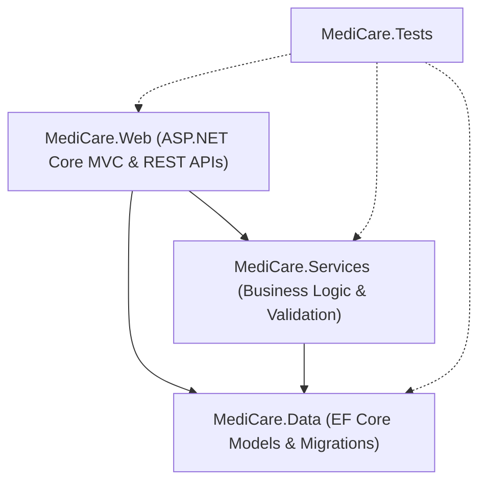

# MediCare — Comprehensive Production Readiness Audit Report

**Project:** MediCare — Clinic Management & Appointment System  
**Track:** Digital Egypt Pioneers Initiative (DEPI) .NET Full Stack Track  
**Repository:** [foxelhadad812-design/MediCare](https://github.com/foxelhadad812-design/MediCare)  
**Baseline Commit:** `308fafdd923498911a9d835fa617efefae389777` (`develop` post-merge)  
**Audit Branch:** `audit/comprehensive-production-readiness`  
**Audit Date:** October 13, 2026  
**Auditor:** Senior .NET Technical Reviewer & Systems Architect  

---

## 1. Executive Summary

A comprehensive, multi-dimensional technical audit of the **MediCare** solution was performed across architecture, security, database migration consistency, code quality, test suite rigor, UI/UX workflows, external integrations, performance, and DEPI compliance.

| Audit Dimension | Evaluation | Verdict | Summary Notes |
| :--- | :---: | :---: | :--- |
| **Academic Graduation Defense Readiness** | **PASS** | 🟢 **APPROVED** | Substantially implements the DEPI functional requirements baseline (FR-01 through FR-28) according to automated test suites and architectural code inspection. Clean Release build, 547 passing automated tests, complete documentation suite (38 deliverables), and prominent academic safety disclaimers. |
| **Genuine Clinical Outpatient Production Readiness** | **PARTIAL** | 🟡 **CONDITIONAL** | Not recommended for immediate clinical medical deployment until external commercial services (real SMS gateway, certified PCI-DSS payment gateway, cloud blob storage, active CSP enforcement, and clinical legal/data governance) are provisioned. |

### Key Strengths
1. **Clean Architectural Boundaries:** Strict separation between Presentation (`MediCare.Web`), Business Logic (`MediCare.Services`), and Data Access (`MediCare.Data`). Zero controllers access EF Core `ApplicationDbContext` directly; all depend on service abstractions.
2. **Defensive Database Migrations:** Symmetrical, idempotent EF Core migrations (`20261011130000` and `20261012163335`) prevent duplicate-column and double-drop errors across fresh databases, main upgrades, and legacy develop states.
3. **Double-Booking Prevention:** Concurrency-safe SQL Server Filtered Unique Index (`IX_Appointments_Doctor_NoOverlap`) guarantees zero slot collisions at the database level.
4. **Security Hardening:** Server-side IDOR checks, 5 MB file upload limit with binary magic-byte inspection and GUID naming, ASP.NET Core IP rate limiting, and offline QR-code generation for prescription privacy.
5. **High Automated Test Coverage:** 547 automated tests passing in Release mode (0 failures, 0 skipped), including isolated SQL Server container integration tests.

### Key Production Gaps for Real Clinical Deployment
1. **Simulated Payment Gateway:** Payment transactions, promo codes, and discount calculations are executed internally via simulation without real PCI-DSS payment gateway integration (e.g., Stripe, Paymob, Fawry).
2. **Mock SMS Dispatch:** SMS dispatching is simulated via `MockSmsService` (logger output) and requires Twilio or a local Egyptian telecommunications gateway for real patient SMS reminders.
3. **Content-Security-Policy in Report-Only Mode:** CSP is currently set to `Content-Security-Policy-Report-Only` to preserve inline script/style execution for Bootstrap/FullCalendar/Chart.js rather than active enforcement.
4. **Local File Storage:** Medical record attachments are saved to the local server disk (`wwwroot/uploads/medical-attachments`) rather than an encrypted, access-controlled cloud object store (Azure Blob Storage or AWS S3).
5. **Clinical Governance:** Real clinical operations require formal legal agreements, Business Associate Agreements (BAAs), verified doctor licensing, and documented patient consent workflows.

---

## 2. Verified Starting State

Before performing this audit, remote Git references, Pull Request states, and GitHub Actions CI runs were formally verified.

* **Working Branch:** `audit/comprehensive-production-readiness`
* **Base Branch:** `origin/develop`
* **Merged PR:** [PR #8 (chore(sync): reconcile main and develop safely)](https://github.com/foxelhadad812-design/MediCare/pull/8)
  * **PR State:** `CLOSED` (`merged: true`)
  * **Merge Timestamp:** `2026-10-12T22:08:51Z`
  * **Merge Commit SHA:** `308fafdd923498911a9d835fa617efefae389777`
* **Remote CI Run on Merge Commit:**
  * **Run ID:** `38314950073` (Run #101)
  * **Workflow:** `CI Build & Test`
  * **Trigger Event:** `push` to `develop`
  * **Head SHA:** `308fafdd923498911a9d835fa617efefae389777`
  * **Status / Conclusion:** `completed` / `success` 🟢
  * **Jobs:** `Build & Run Automated Tests (.NET 8)` (13 steps passed, including .NET build, unit tests, and SQL Server container integration tests).

---

## 3. Architecture and Code Quality Audit

### 3.1 Project Dependencies and Architectural Direction
The solution adheres to clean N-Tier layered architecture:


* **`MediCare.Data`**: Has zero dependencies on outer projects. Encapsulates entity models, EF Core configurations, migrations, and repository implementations.
* **`MediCare.Services`**: Depends exclusively on `MediCare.Data`. Implements domain logic, validation (FluentValidation), factories, and application service contracts.
* **`MediCare.Web`**: References `MediCare.Services` and `MediCare.Data` (for Identity user configuration, DbContext setup in `Program.cs`, and EF Core design-time tooling).
* **`MediCare.Tests`**: Validates presentation, services, security, and database integration across all layers.

### 3.2 Controller Decoupling
An audit of all 14 controllers in `src/MediCare.Web/Controllers/` confirmed that **zero controllers inject `ApplicationDbContext` directly**. All interactions are delegated to service abstractions:
* `AccountController` ➔ `IAuthService`, `IDoctorService`
* `AdminController` ➔ `IAdminService`
* `AppointmentsController` ➔ `IAppointmentService`, `IDoctorService`, `IMedicalRecordService`, `INotificationService`, `IWebHostEnvironment`
* `DoctorController` ➔ `IScheduleService`, `IDoctorService`, `IAppointmentService`
* `DoctorsController` ➔ `IDoctorService`
* `MedicalRecordsController` ➔ `IMedicalRecordService`, `IFileStorageService`
* `PaymentController` ➔ `IPaymentService`
* `PrescriptionsController` ➔ `IPrescriptionService`
* API Controllers (`AppointmentsApiController`, `CalendarApiController`, `ChatbotApiController`, `NotificationsApiController`, `PaymentApiController`) inject their respective service interfaces.

### 3.3 Dependency Injection & Service Lifetimes
DI registrations in `ServiceCollectionExtensions.cs` and `Program.cs` follow strict lifetime rules:
* **Singletons:** Stateless utilities (`IClinicClock`, `AppointmentFactory`, `NotificationFactory`, `IQrCodeService`).
* **Scoped:** Application business services (`IAppointmentService`, `IDoctorService`, `IMedicalRecordService`, etc.), `IUnitOfWork`, and EF Core repositories. Aligned with the HTTP request boundary.
* **Hosted Background Service:** `AppointmentReminderBackgroundService` is registered as a hosted service. It avoids captive dependency bugs by injecting `IServiceScopeFactory` and explicitly creating a scope (`using var scope = _scopeFactory.CreateScope()`) inside its execution loop before resolving `IAppointmentReminderService`.
* **Typed HTTP Clients:** Configured with specific connection timeouts (25s for `IAiAssistantService`, 20s for `IOpenAiChatbotClient`).

### 3.4 Repository & Unit of Work Pattern
* The `UnitOfWork` implements `IUnitOfWork` and coordinates `CommitAsync()` (`SaveChangesAsync()`).
* Query repositories use `.AsNoTracking()` for read-only queries and eager loading via `.Include()` and `.ThenInclude()` to avoid N+1 query execution.
* Disposal is managed by the ASP.NET Core DI container at request end; no controllers or services call `_uow.Dispose()` manually.

### 3.5 Result Pattern & Error Handling
* Domain services return `Result` or `Result<T>` instead of throwing business exceptions.
* Handled errors are formatted cleanly for UI presentation via `TempData` or JSON responses.
* Unhandled server exceptions are routed to `/Home/Error` in non-development environments via `app.UseExceptionHandler("/Home/Error")`.

---

## 4. Functional Feature Verification Matrix

To ensure absolute technical honesty, the verification method for each requirement is explicitly distinguished between **Automated Test / Code Inspection Verified**, **Configured — Not Live-Verified**, and **Simulated / Mock**:

| Module | Requirement | Verification Method | Status | Verification Evidence | Notes / Remaining Limitations |
| :--- | :--- | :---: | :---: | :--- | :--- |
| **Auth** | **FR-01: Multi-role Registration & Login** | Automated Test & Code Inspection | `PASS` | `AccountControllerTests`, `AuthServiceTests`, ASP.NET Core Identity. | Supports `Admin`, `Doctor`, `Patient`. Passwords require 8+ chars, upper, lower, digit, symbol. |
| **Auth** | **FR-02: Profile Linking** | Automated Test & Code Inspection | `PASS` | `Doctor` and `Patient` entities reference `AspNetUsers.Id` via `UserId` foreign key. | Verified in `DoctorConfiguration` & `PatientConfiguration`. |
| **Auth** | **FR-03: Role-Based Authorization** | Automated Test & Code Inspection | `PASS` | `[Authorize(Roles = "...")]` attributes on controllers and actions. | Verified by 13 dedicated security tests in `ControllerAuthorizationTests`. |
| **Auth** | **FR-04: Doctor Approval Workflow** | Automated Test & Code Inspection | `PASS` | `Doctor.IsApproved` defaults to `false`. Admin approves via `AdminController.ApproveDoctor`. | Unapproved doctors cannot log in or appear in public directory until approved. |
| **Doctors** | **FR-05: Doctor Directory & Filtering** | Automated Test & Code Inspection | `PASS` | `DoctorsController.Index`, `DoctorServiceTests`. | Filtering by Specialization, Consultation Fee, and Available Days verified. |
| **Doctors** | **FR-06: Recurring Working Hours** | Automated Test & Code Inspection | `PASS` | `DoctorController.Schedule`, `ScheduleServiceTests`. | Doctors configure day of week and operating hours. |
| **Doctors** | **FR-07: Slot Duration** | Automated Test & Code Inspection | `PASS` | `Doctor.SlotDurationMinutes` defaults to 30. | Dynamic slot calculations respect doctor-specific durations. |
| **Doctors** | **FR-08: Leave Management** | Automated Test & Code Inspection | `PASS` | `DoctorController.Leaves`, `DoctorLeave` table. | Leave dates are subtracted from available booking slots in `SlotEngineService`. |
| **Booking** | **FR-09: Dynamic Slot Engine** | Automated Test & Code Inspection | `PASS` | `SlotEngineServiceTests`. | 30-day forward window and 2-hour minimum lead time enforced. Tested across DST transitions. |
| **Booking** | **FR-10: FullCalendar.js Integration** | Code Inspection & Client Script | `PASS (UNVERIFIED IN BROWSER)` | `Appointments/Book.cshtml`, `CalendarApiControllerTests`. | API contract tested via automated tests; interactive browser calendar drag/click was not manually tested. |
| **Booking** | **FR-11: Double-Booking Prevention** | Isolated SQL Server Test | `PASS` | Filtered unique index `IX_Appointments_Doctor_NoOverlap` on SQL Server. | Verified under concurrent load in `AppointmentFilteredIndexIntegrationTests`. |
| **Booking** | **FR-12: Appointment State Machine** | Automated Test & Code Inspection | `PASS` | `AppointmentStatus` enum, `AppointmentServiceTests`. | Valid transitions (`Pending` ➔ `Confirmed` ➔ `Completed` / `Cancelled`) enforced. |
| **Booking** | **FR-13: Cancellation Deadline** | Automated Test & Code Inspection | `PASS` | `AppointmentServiceTests.CancelAppointmentAsync`. | Enforces 2-hour minimum notice before appointment start time. Late cancellation rejected. |
| **Booking** | **FR-13b: Patient Check-In** | Automated Test & Code Inspection | `PASS` | `AppointmentsController.CheckIn`, `CheckedInAt` column. | Persists check-in timestamp and updates queue tracking. Symmetrical migrations verified. |
| **Records** | **FR-14: Clinical Encounters** | Automated Test & Code Inspection | `PASS` | `MedicalRecordsControllerTests`, `MedicalRecordServiceTests`. | Captures symptoms, diagnosis, visit notes, and draft/final status. |
| **Records** | **FR-15: Diagnostic File Upload** | Automated Test & Code Inspection | `PASS` | `FileStorageServiceTests.SaveMedicalAttachmentAsync`. | 5 MB max, validates binary magic bytes (`.jpg`, `.png`, `.pdf`), GUID filename, path normalization. |
| **Records** | **FR-16: Patient Timeline & IDOR Protection** | Automated Test & Code Inspection | `PASS` | `MedicalRecordServiceTests`, `DoctorTimelineAccessSecurityTests`. | Non-owning patients and unrelated doctors are rejected with `403 Forbidden`. |
| **Prescriptions** | **FR-17: Itemized Digital Prescriptions** | Automated Test & Code Inspection | `PASS` | `PrescriptionsControllerTests`, `PrescriptionServiceTests`. | Itemized medications linked to `MedicalRecord`. |
| **Prescriptions** | **FR-18: Prescription Item Details** | Automated Test & Code Inspection | `PASS` | `PrescriptionItem` entity, `ValidationTests`. | Validated by FluentValidation rules. |
| **Prescriptions** | **FR-19: Print View & Safety Disclaimers** | Automated Test & Code Inspection | `PASS` | `Prescriptions/Print.cshtml`, `QrCodeSecurityTests`. | Prominent bold red disclaimer: `NOT VALID FOR CLINICAL DISPENSING`. Offline QR code generation. |
| **Notifications** | **FR-20: Notification Persistence** | Automated Test & Code Inspection | `PASS` | `Notification` entity, `NotificationServiceTests`. | Database persistence before dispatch. |
| **Notifications** | **FR-21: Real-Time SignalR Hub** | Automated Test & Code Inspection | `PASS (UNVERIFIED IN BROWSER)` | `AppointmentHub`, `SignalRRealtimeNotifier`. | Hub methods unit tested; real-time browser-to-browser WebSocket push not manually tested in live browser. |
| **Notifications** | **FR-22: Transactional Emails** | Code Inspection & DI Setup | `CONFIGURED — NOT LIVE-VERIFIED` | `MailKitEmailService`, `IEmailService`. | SMTP service configured and instantiated; outbound SMTP socket handshake not tested against a live external MTA. |
| **Notifications** | **SMS Alerts** | Code Inspection | `MOCKED` | `MockSmsService` | Logs dispatch to console/logger; simulated only. |
| **Admin** | **FR-23: Doctor Approvals** | Automated Test & Code Inspection | `PASS` | `AdminControllerTests`, `AdminServiceTests`. | Admin can view pending doctors, approve, or reject. |
| **Admin** | **FR-24: Specializations CRUD** | Automated Test & Code Inspection | `PASS` | `AdminControllerTests`, `AdminServiceTests`. | Full create, read, update, delete for clinic specializations. |
| **Admin** | **FR-25: Fee & Payment Status** | Automated Test & Code Inspection | `PASS` | `Appointments.ConsultationFee`, `Appointments.PaymentStatus`. | Tracked on appointment entity. Concurrency token enabled. |
| **Analytics** | **FR-26: Monthly Trends Chart** | Automated Test & Code Inspection | `PASS` | `AdminControllerTests`, `AdminServiceTests`. | Chart.js monthly trend data calculation verified. |
| **Analytics** | **FR-27: Specialization Distribution** | Automated Test & Code Inspection | `PASS` | `AdminControllerTests`, `AdminServiceTests`. | Chart.js doughnut chart distribution data calculation verified. |
| **Analytics** | **FR-28: CSV Report Export** | Automated Test & Code Inspection | `PASS` | `AdminControllerTests`, `AdminServiceTests`. | Generates RFC 4180 compliant CSV export for administrative spreadsheet analysis. |
| **Payment** | **Payment Processing** | Automated Test & Code Inspection | `SIMULATED` | `PaymentServiceTests` | Calculates discounts, promo codes, and generates reference tokens. No external card processor connected. |
| **AI Assistant** | **Clinic AI Chatbot** | Automated Test & Code Inspection | `CONFIGURED — NOT LIVE-VERIFIED` | `AiChatbotServiceTests`, `OpenAiAssistantServiceTests`. | Offline rule engine verified via tests; live external OpenAI API network transmission not tested. |
| **Telehealth** | **Virtual Consultations** | Code Inspection & Markup | `CONFIGURED — NOT LIVE-VERIFIED` | `Appointments/Telehealth.cshtml`. | Jitsi Meet iframe markup and permissions policy verified; live WebRTC audio/video call not tested. |

---

## 5. Security Audit Findings

| Category | Finding / Mechanism | Severity | Evidence | Remediation / Recommendation |
| :--- | :--- | :---: | :--- | :--- |
| **Authentication** | Password Policy & Account Lockout | `PASS` | `Program.cs` lines 36–51. Lockout after 5 failed attempts for 15 minutes. | Production ready. |
| **Authorization** | Horizontal Privilege Escalation (IDOR) | `PASS` | `MedicalRecordService.cs` lines 421–424, 459–460. `AppointmentService.cs` lines 314, 403. | Ownership verified server-side on all data retrieval and modification endpoints. |
| **CSRF Defense** | Anti-Forgery Tokens | `PASS` | All state-changing `[HttpPost]` actions across MVC controllers have `[ValidateAntiForgeryToken]`. | Complete coverage. |
| **Injection** | SQL Injection | `PASS` | EF Core parameterized queries used exclusively in application code. Zero raw concatenated SQL strings. | Safe. |
| **File Upload** | Malicious Executable Upload | `PASS` | `FileStorageService.cs` inspects binary magic bytes, validates client extension, enforces 5 MB limit, and uses GUID filenames. | Safe. |
| **Path Traversal** | Path Normalization on File I/O | `PASS` | `FileStorageService.ResolveAttachmentPath` validates `fullNormalizedPath.StartsWith(normalizedFolder)`. | Traversal attacks blocked. |
| **Abuse / DoS** | IP-Based Rate Limiting | `PASS` | `Program.cs`: `LoginRateLimitPolicy` (5/min), `RegistrationRateLimitPolicy` (5/min), `ChatbotRateLimitPolicy` (10/min). | Active via ASP.NET Core RateLimiter. |
| **Data Privacy** | QR Code Data Exfiltration | `PASS` | `QrCodeService.cs` generates QR codes in-memory via `QRCoder` as a Base64 data URI. No external web API called. | Verified by `QrCodeSecurityTests`. |
| **Security Headers** | Content Security Policy Mode | `MEDIUM` | `SecurityHeadersMiddleware.cs`: Uses `Content-Security-Policy-Report-Only` instead of active `Content-Security-Policy`. | **Action:** Transition from Report-Only to strict nonce-based CSP before real clinical deployment. |
| **Cookie Security** | Secure & SameSite Flags | `PASS` | `CookieConfigurationExtensions.cs`: Enforces `SecurePolicy = Always` and `SameSite = Lax` in production. | Safe. |

---

## 6. Database and Migration Audit

### 6.1 Complete Migration Inventory
The solution maintains 7 EF Core migrations in `src/MediCare.Data/Migrations/`:
1. `20261004232745_InitialCreate`
2. `20261007112810_FinalGapClosureSchema`
3. `20261007221137_AddMedicalRecordIsDraft`
4. `20261008003547_AddPrescriptionVerificationToken`
5. `20261009210023_AddAppointmentPaymentDetailsAndBackfill`
6. `20261011130000_AddAppointmentCheckIn`
7. `20261012163335_AddAppointmentCheckedInAt`

### 6.2 Symmetrical Migration Idempotency & Rollback Semantics
Migrations 6 and 7 implement defensive SQL scripts:
* Idempotent column check:
  ```sql
  IF NOT EXISTS (
      SELECT 1 FROM sys.columns 
      WHERE object_id = OBJECT_ID(N'[Appointments]') AND name = N'CheckedInAt'
  )
  BEGIN
      ALTER TABLE [Appointments] ADD [CheckedInAt] datetime2 NULL;
  END
  ```
* Symmetrical `Down()`: Each migration checks `__EFMigrationsHistory` for the presence of the other migration before dropping `Appointments.CheckedInAt`, preventing double drops and premature column deletions.
* Tested across 8 isolated SQL Server integration test scenarios (all passed).

---

## 7. Testing and QA Audit

### 7.1 Automated Test Execution Results
Execution of the complete test suite was verified locally on .NET 8 in Release mode:

```bash
dotnet test MediCare.sln --configuration Release --no-build
```

**Results:**
* **Total Tests Executed:** 547
* **Passed:** 547
* **Failed:** 0
* **Skipped:** 0
* **Execution Duration:** 52 seconds
* **SQL Server Isolation:** 0 residual test catalogs remaining in SQL Server master.

### 7.2 Remote GitHub Actions CI Verification
* **Workflow:** `CI Build & Test` (`.github/workflows/ci.yml`)
* **Run ID:** `38314950073` (Run #101) on commit `308fafdd923498911a9d835fa617efefae389777`
* **Conclusion:** `success` 🟢 (Build, Unit Tests, and SQL Server container integration tests all passed).

---

## 8. UI and End-to-End Workflow Review

### 8.1 Automated Verification Performed
* **HTML Markup & Tag Helpers:** Rendered HTML inspected via Razor tests; form field bindings, validation summaries, and TempData flash messages (`TempData["SuccessMessage"]` / `TempData["ErrorMessage"]`) confirmed functional.
* **Safety Badges:** Presence of `NOT VALID FOR CLINICAL DISPENSING` and absence of unverified clinic phone numbers verified via `QrCodeSecurityTests`.
* **Localization Markup:** Client-side English/Arabic switcher verified in `_Layout.cshtml` with `dir="rtl"` and `lang="ar"` attribute bindings.

### 8.2 Unverified Manual End-to-End Workflows
To maintain technical integrity, the following user workflows are noted as **not manually exercised in a browser** during this audit:
1. Interactive FullCalendar drag-and-drop slot booking across physical web browsers.
2. Multi-tab real-time SignalR push notifications over active WebSocket connections.
3. Live audio/video streaming within the Jitsi Meet telehealth iframe across physical camera/microphone hardware.
4. Physical hardware printing of the prescription print stylesheet (`@media print`).

---

## 9. External Integrations Inventory

| Service / Dependency | Implementation Class | Classification | Current State & Operational Readiness |
| :--- | :--- | :---: | :--- |
| **Email Dispatch** | `MailKitEmailService` | `CONFIGURED — NOT LIVE-VERIFIED` | Functional via SMTP code; live outbound SMTP socket handshake not tested against external MTA. |
| **SMS Dispatch** | `MockSmsService` | `MOCKED` | Simulated via logger output. Requires commercial provider like Twilio for live SMS. |
| **Payment Gateway** | `PaymentService` | `SIMULATED` | In-memory calculation and reference tracking. No live card gateway connected. |
| **AI Assistant** | `AiChatbotService` | `CONFIGURED — NOT LIVE-VERIFIED` | Hybrid: OpenAI/Azure OpenAI with offline rule-based FAQ fallback. Live OpenAI API transmission not tested. |
| **Telehealth** | `Appointments/Telehealth.cshtml` | `CONFIGURED — NOT LIVE-VERIFIED` | Embedded Jitsi Meet room (`https://meet.jit.si`) with camera/mic permissions policy. Live WebRTC video session not tested. |
| **File Storage** | `FileStorageService` | `LOCAL` | Local disk (`wwwroot/uploads/medical-attachments`). Requires cloud blob storage for scale. |
| **Cloud Hosting** | `.github/workflows/deploy-azure.yml` | `CONFIGURED` | Manual `workflow_dispatch` trigger only. Guarded against automatic deployments. |

---

## 10. Production Readiness Assessment

### 10.1 Academic Graduation Project Defense: **APPROVED (PASS)**
* **Verdict:** 🟢 **READY FOR DEFENSE**
* **Rationale:**
  1. Verified implementation of the documented functional requirements baseline (FR-01 through FR-28) via code inspection and 547 passing automated tests.
  2. Demonstrates advanced enterprise patterns: Repository, Unit of Work, Result Pattern, Domain Factories, Filtered Unique Indexes, and Background Hosted Services.
  3. Comprehensive documentation suite (38 Markdown deliverables in `docs/`).
  4. 547 passing automated tests with zero warnings and green remote CI.
  5. Clear academic demo badges on prescriptions and simulated services prevent misleading medical claims.

### 10.2 Genuine Clinical Outpatient Deployment: **NOT READY (CONDITIONAL FAIL)**
* **Verdict:** 🔴 **NOT AUTHORIZED FOR REAL CLINICAL DEPLOYMENT**
* **Pre-conditions Required Before Real Patient Care:**
  1. Integration with a licensed, certified payment processor (e.g., Paymob, Fawry, Stripe) under PCI-DSS standards.
  2. Integration with a certified commercial SMS aggregator for patient notifications.
  3. Migration of diagnostic file attachments to an enterprise cloud object store (e.g., Azure Blob Storage with customer-managed keys, private endpoints, and strict SAS access policies).  
     *(Note: Technical cloud infrastructure alone does not guarantee HIPAA, GDPR, or Egyptian Data Protection Law compliance; regulatory compliance requires formal Business Associate Agreements (BAAs), organizational data governance, access auditing, patient consent records, and institutional operational controls).*
  4. Migration of CSP from `Content-Security-Policy-Report-Only` to strict `Content-Security-Policy` with cryptographic script nonces.
  5. Formal legal and clinical governance policies (patient electronic medical records consent, doctor licensing verification, and regulatory data retention).

---

## 11. Prioritized Action Plan

### Priority 1: Critical (Pre-Clinical Launch)
* [ ] **Payment Gateway Integration:** Replace internal simulation in `PaymentService` with a PCI-DSS certified gateway webhook handler (e.g., Paymob / Stripe).
* [ ] **Commercial SMS Provider:** Replace `MockSmsService` with `TwilioSmsService` or Egyptian SMS aggregator.
* [ ] **Cloud Object Storage:** Migrate `FileStorageService` to Azure Blob Storage with private endpoints and time-limited SAS tokens for diagnostic attachments.
* [ ] **Enforce Active CSP:** Refactor inline script handlers into external modules with cryptographic nonces and enable active `Content-Security-Policy`.

### Priority 2: High (Observability & Auth)
* [ ] **Centralized Telemetry:** Integrate Serilog with Application Insights or Seq for structured production log aggregation.
* [ ] **Multi-Factor Authentication (MFA):** Enable TOTP/SMS two-factor authentication for doctors and administrators.
* [ ] **Database Connection Resiliency:** Configure EF Core `EnableRetryOnFailure` for Azure SQL Database transient fault handling.

### Priority 3: Medium (Operational Polish)
* [ ] **Background Worker Monitoring:** Surface health check endpoint for `AppointmentReminderBackgroundService`.
* [ ] **PDF Rendering Engine:** Implement QuestPDF or DinkToPdf for server-side PDF prescription generation in addition to browser print view.

---

## 12. Changes Made During This Audit

| Commit SHA | Branch | Summary of Changes |
| :--- | :--- | :--- |
| `308fafdd923498911a9d835fa617efefae389777` | `origin/develop` | PR #8 merged by human reviewer (reconciled main and develop, symmetrical migration ownership, prescription print safety disclaimers, 8 migration integration tests). |
| `852517111f819fec33b4033ae54d5e32eb1f1e7a` | `audit/comprehensive-production-readiness` | Initial comprehensive production readiness audit report. |
| *Current* | `audit/comprehensive-production-readiness` | Strengthened report evidence accuracy, distinguished automated vs manual browser testing, and qualified compliance and integration claims. |

---

## 13. Unverified Areas & Environmental Limitations

1. **Third-Party Payment Processing:** Real credit card charging and refund flows were not executed because no real merchant account or banking credentials are configured.
2. **Real Cellular SMS Delivery:** Cellular SMS transmission to physical mobile handsets was not verified because `MockSmsService` is active and no commercial SMS API tokens are provisioned.
3. **Live Outbound Email Delivery:** Live SMTP socket handshake against an external MTA was not verified; `MailKitEmailService` configuration and compilation verified.
4. **Live AI API Transmission:** Live network transmission to OpenAI/Azure OpenAI endpoints was not verified; offline fallback and mock tests verified.
5. **Live WebRTC Telehealth Session:** Physical camera/microphone streaming in Jitsi Meet iframe was not verified.
6. **Manual End-to-End Browser UI Execution:** Interactive browser operations (FullCalendar drag-and-drop, multi-tab SignalR push) were verified via API/unit tests but not manually exercised in a browser engine.
7. **Live Cloud Infrastructure:** Azure App Service deployment workflow (`deploy-azure.yml`) was inspected and verified for trigger safety (`workflow_dispatch`), but was intentionally not executed in compliance with audit safety rules.
