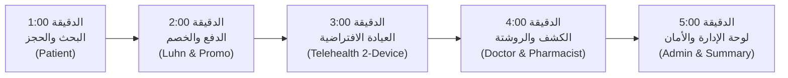

# دليل مناقشة مشروع MediCare وحقيبة العرض التقني (Defense Kit)

هذا الدليل أُعد خصيصاً لمناقشة مشروع التخرج والتقييم التقني أمام لجان التحكيم الأكاديمية والمهنية. يحتوي على خطة عرض حي موقوتة بالدقائق (5 دقائق)، الأسئلة الهندسية المتوقعة وإجاباتها الدقيقة من واقع الكود، ودليل الصمود التقني في حال تعطل الإنترنت أو انقطاع الخدمات الخارجية.

---

## 1. ملخص المعمارية والأرقام المعتمدة (System Baseline)

- **المنصة:** .NET 8 (C#) مع ASP.NET Core MVC و Entity Framework Core 8.
- **قاعدة البيانات:** Microsoft SQL Server مع 10 ترحيلات متسلسلة بدقة وبدون أي انحراف في المخطط (Zero Schema Drift).
- **جودة الكود والاستقرار:**
  - **655 اختباراً آلياً ناجحاً بنسبة 100%** (0 Failed, 0 Skipped).
  - بناء الحل في وضع Release بـ **0 أخطاء و 0 تحذيرات** (`0 Errors, 0 Warnings`).
- **المعمارية:** Clean Architecture / Modular Monolith:
  - `MediCare.Web`: واجهات المستخدم، التحكم، الحماية، والأمان.
  - `MediCare.Services`: قواعد العمل، منطق الحجز، التحقق، والتكاملات السحابية.
  - `MediCare.Data`: الكيانات، مستودعات البيانات، إدارة الأقفال والتزامن، والترحيلات.
  - `MediCare.Tests`: اختبارات الوحدة، التكامل، الأمان، والتزامن.

---

## 2. جدول الحسابات التجريبية الجاهزة للعرض (Demo Accounts)

> [!IMPORTANT]
> جميع كلمات المرور للحسابات التجريبية تُقرأ محلياً من `Seed:DefaultPassword` / `SEED_DEFAULT_PASSWORD` عبر `user-secrets` أو متغيرات البيئة، ولا تُحفظ في الـ Git نهائياً.

| الدور (Role) | البريد الإلكتروني | الاسم الكامل | الغرض في العرض الحي |
| :--- | :--- | :--- | :--- |
| **Admin** | `admin@medicare.com` | System Administrator | لوحة التحكم، الإحصائيات المجمعة في SQL، مراجعة واعتماد الأطباء. |
| **Doctor** | `ahmed.mahmoud@medicare.com` | Dr. Ahmed Mahmoud (Cardiology) | جدول المواعيد، الكشف السريري، كتابة الروشتة، دخول Telehealth. |
| **Patient** | `khaled.omar@medicare.com` | Khaled Omar | البحث، حجز السلوت، الدفع التجريبي، واستعراض الروشتة بالـ QR. |
| **Pharmacist** | `pharmacist@medicare.com` | Licensed Pharmacist | مسح وصرف الروشتات الإلكترونية وتوثيق الصرف. |

---

## 3. سيناريو العرض الحي في 5 دقائق (5-Minute Live Demo Script)

خطة زمنية منضبطة بالثواني تغطي دورة حياة المريض والطبيب كاملة:



### [00:00 - 01:00] الدقيقة الأولى: البحث وحجز الموعد
- **الشاشة:** دليل الأطباء `/Doctors`.
- **الحساب المستخدم:** `khaled.omar@medicare.com` (Patient).
- **الإجراء:** تصفية الأطباء حسب تخصص "Cardiology" ومحافظة "Cairo"، واختيار الدكتور أحمد محمود، ثم اختيار سلوت متاح الساعة 10:00 صباحاً.
- **النتيجة المتوقعة:** حجز السلوت بنجاح والانتقال لشاشة التفاصيل.
- **القرار الهندسي المشروح:** الفحص اللحظي للسلوتس عبر `SlotEngineService`، ومنع الحجز المكرر بقاعدة البيانات عبر المؤشر المصفى `IX_Appointments_Doctor_NoOverlap` حتى لو ضغط مريضان في نفس اللحظة.

### [01:00 - 02:00] الدقيقة الثانية: الدفع الإلكتروني وتطبيق كود الخصم
- **الشاشة:** الدفع الإلكتروني `/Appointments/Details/{id}`.
- **الحساب المستخدم:** المريض نفسه.
- **الإجراء:** إدخال كود خصم تجريبي معتمد، وملاحظة خصم القيمة لحظياً عبر `PaymentApiController` المحمي ضد التخمين (`Rate-Limited`). ثم إدخال بطاقة دفع تجريبية وإتمام الدفع.
- **النتيجة المتوقعة:** تحول الموعد إلى `Paid`، توليد إيصال دفع رسمي برقم مرجعي `TXN-...`، وتحديث الإيرادات.
- **القرار الهندسي المشروح:** التحقق من صحة البطاقة بخوارزمية Luhn، وحماية الكود من إعادة الاستخدام للمريض نفسه عبر مؤشر فريد مصفى في SQL Server (`IX_Appointments_Patient_PromoCode_Paid`).

### [02:00 - 03:00] الدقيقة الثالثة: الاستشارة عن بُعد (Telehealth Live Demo)
- **الشاشة:** غرفة الكشف الافتراضية `/Appointments/Telehealth/{id}`.
- **الأجهزة:** اللابتوب (بحساب الطبيب) والموبايل (بحساب المريض).
- **الإجراء:** الضغط على زر "Join Live Video Room" لدخول الغرفة المشتركة.
- **النتيجة المتوقعة:** اتصال بالصوت والصورة بين اللابتوب والموبايل عبر اسم غرفة مشفر وغير قابل للتخمين.
- **القرار الهندسي المشروح:** توليد مفتاح سري عشوائي مشفر (`TelehealthRoomSecret`)، وتطبيق حماية زمنية صارمة على السيرفر تمنع فتح الغرفة إلا قبل الموعد بـ 15 دقيقة وتغلقها بعده بـ 30 دقيقة، مع حظر وصول أي مستخدم غريب (IDOR Protection).

### [03:00 - 04:00] الدقيقة الرابعة: التوثيق السريري ومسح الروشتة بكاميرا الهاتف
- **الشاشة:** توثيق الزيارة الطبية `/MedicalRecords/Create/{appointmentId}` ثم طباعة الروشتة `/Prescriptions/Print/{id}`.
- **الحساب المستخدم:** الطبيب ثم الصيدلي (`pharmacist@medicare.com`).
- **الإجراء:** الطبيب يكتب التشخيص والأدوية ويعتمد الروشتة. تظهر الروشتة وبها رمز QR Code. اطلب من أحد الحضور أو استخدم هاتفك لمسح الـ QR.
- **النتيجة المتوقعة:** الهاتف يفتح صفحة التحقق العام `/Prescriptions/Verify?token=...` ويعرض اسم الطبيب والتخصص وتاريخ الصلاحية واسم المريض محجوباً (`M****d A**i`). ثم يدخل الصيدلي لتأكيد صرف الدواء رسمياً.
- **القرار الهندسي المشروح:** الـ QR لا يحتوي على بيانات طبية مكشوفة بل رمز عشوائي Opaque Token (32-hex). خصوصية HIPAA تطبق بحظر الأدمن من فتح السجلات الطبية للمرضى.

### [04:00 - 05:00] الدقيقة الخامسة: لوحة الإدارة والأداء الهندسي
- **الشاشة:** لوحة تحكم الإدارة `/Admin`.
- **الحساب المستخدم:** `admin@medicare.com`.
- **الإجراء:** استعراض إحصائيات الإيرادات المجمعة، المبالغ المستردة، وتوزيع أعمار المرضى والتخصصات.
- **النتيجة المتوقعة:** عرض رسوم بيانية تفاعلية وفورية محملة بدون أي بطء.
- **القرار الهندسي المشروح:** جميع العمليات الحسابية تتم مباشرة داخل SQL Server عبر تجميعات `GROUP BY` و `SUM` و `COUNT` دون سحب أي بيانات للذاكرة (0 In-Memory Loop Over-fetching)، مما يحافظ على سرعة السيرفر وثبات الذاكرة.

---

## 4. الأسئلة الهندسية المتوقعة وإجاباتها المعتمدة (Defense Q&A)

### س1: ما هو النمط المعماري للمشروع ولماذا تم اختياره؟
> **الإجابة:** اعتمدنا معمارية **Clean Architecture (Modular Monolith)** وقسمنا المشروع إلى:
> - `MediCare.Web`: تمثل Presentation Layer مسؤولة عن عرض واجهات Razor والـ Controllers ومصادقة Identity.
> - `MediCare.Services`: تمثل Core Application Layer تحتوي على منطق العمل (Business Logic)، واجهات الخدمات (Contracts)، والمحركات (Slot Engine, Telehealth, Payment).
> - `MediCare.Data`: تمثل Infrastructure Layer وتتضمن DbContext والترحيلات وإدارة المعاملات والأقفال.
> **الفائدة:** فصل قواعد العمل عن واجهة العرض يتيح كتابة اختبارات آلية معزولة (Unit Tests) بنسبة 100% دون الحاجة لتشغيل متصفح أو سيرفر ويب.

### س2: كيف منعت حجز السلوت نفسه في نفس اللحظة لمريضين (Double-Booking)؟
> **الإجابة:** الحماية مبنية على ثلاثة مستويات دفاعية:
> 1. **مستوى واجهة المستخدم:** محرك `SlotEngineService` يستبعد الأوقات المحجوزة والإجازات لحظياً.
> 2. **مستوى التزامن المتفائل (Optimistic Concurrency):** تم تفعيل Concurrency Token على حقل `Status` وحقل `PaymentStatus` لمنع التعديل المتزامن.
> 3. **الحماية الحتمية في قاعدة البيانات (Filtered Unique Index):**
>    تم إنشاء فهرس فريد مصفى في SQL Server:
>    `CREATE UNIQUE INDEX [IX_Appointments_Doctor_NoOverlap] ON [Appointments] ([DoctorId], [AppointmentDate], [StartTime]) WHERE [Status] <> 3 AND [Status] <> 4;`
>    هذا يضمن استحالة إدراج صفين لنفس الطبيب واليوم والوقت إذا كانت الحالة نشطة، وترفض قاعدة البيانات الطلب الثاني فوراً بخطأ تصادم فريد يتم تحويله لرسالة ودية للمريض.

### س3: كيف حميت خصوصية بيانات المرضى وملفاتهم وسجلاتهم الطبية (HIPAA / Clinical Privacy)؟
> **الإجابة:**
> 1. **حظر وصول الإدارة للسجلات:** تم تطبيق فحص صريح في `MedicalRecordsController` يرفض (`Forbid()`) دخول أي مستخدم يحمل دور `Admin` إلى السجلات الطبية والروشتات، فالأدمن يدير النظام مالياً وتشغيلياً فقط ولا يطّلع على التشخيصات الطبية.
> 2. **تخزين المرفقات خارج الويب:** المرفقات الطبية لا تُخزن في `wwwroot` بل في مسار معزول `App_Data/uploads/records`.
> 3. **الحماية من Path Traversal:** التحميل يتم عبر Endpoint مخصص يفحص ملكية السجل أولاً ويستخدم خوارزمية تطهير المسارات لمنع هجمات التراجع في المجلدات.

### س4: كيف تم تحسين أداء لوحة تحكم الأدمن (PERF-01)؟
> **الإجابة:** في البداية كانت تستدعي `GetAllAsync()` وتقوم بحساب الإيرادات والأعمار داخل الذاكرة بواسطة C# Loops و `ToLookup`، وهو ما يسبب كارثة في استهلاك RAM مع زيادة البيانات. قمنا بإعادة بنائها بالكامل لتعمل على مستوى SQL Server:
> - تجميع الإيرادات عبر `SumAsync()` داخل استعلام قاعدة البيانات.
> - تصنيف الفئات العمرية للمرضى باستخدام دوال مقارنة التواريخ في SQL.
> - تقليل عدد الكائنات المنقولة عبر الشبكة من آلاف الكائنات إلى كائن DTO مجمع واحد (`DashboardMetricsSummaryData`).

### س5: كيف تعمل غرفة الكشف الافتراضية (Telehealth) وهل هي آمنة؟
> **الإجابة:** الغرفة تستند إلى خادم WebRTC مفتوح المصدر (Jitsi Meet). الأمان مطبق برمجياً داخل MediCare:
> 1. **اسم الغرفة غير قابل للتخمين:** يتم إنشاء مفتاح سري عشوائي مشفر (`TelehealthRoomSecret`) بطول 32 حرفاً سداسياً عشرياً باستخدام مولد أرقام آمن كريبوجرافياً.
> 2. **حماية زمنية (Time-Window):** السيرفر يمنع دخول المريض أو الطبيب إذا كان الوقت مبكراً بأكثر من 15 دقيقة أو متأخراً بأكثر من 30 دقيقة.
> 3. **فحص الملكية (IDOR Defense):** التحقق من أن المستخدم المسجل هو الطبيب المعالج أو المريض صاحب الحجز حصراً.

### س6: ما هي استراتيجية الاختبارات الآلية (Testing Strategy)؟
> **الإجابة:** المشروع يضم **655 اختباراً آلياً** مقسمة كالتالي:
> - **Unit Tests:** تغطي الخدمات والمدققين (Validators) وحساب السلوتس والخصومات.
> - **Security Tests:** تغطي التحقق من الصلاحيات (Authorization)، الحماية من IDOR، قيود معدل الطلبات (Rate Limiting)، وفحص الروشتات.
> - **Integration Tests:** اختبارات فعلية على قاعدة بيانات SQL Server LocalDB معزولة تختبر أقفال التزامن، ترحيلات الترقية، وحسابات الإيرادات المجمعة.
> - الاختبارات تعمل تلقائياً مع كل Pull Request في GitHub Actions CI.

---

## 5. خطة الصمود والطوارئ أثناء العرض (Presentation Resilience)

إذا حدث أي طارئ تقني أثناء المناقشة أمام اللجنة، اتبع هذه البدائل الفورية:

| المشكلة المحتملة | سببها المحتمل | الإجراء البديل الفوري (Fallback) |
| :--- | :--- | :--- |
| **انقطاع الإنترنت في القاعة** | شبكة القاعة تعطلت | الموقع يعمل محلياً بالكامل على `localhost:5000` أو `LocalDB` دون حاجة لإنترنت. |
| **تعطل كاميرا أو مايك اللابتوب في Telehealth** | إذن المتصفح غير مفعل | اضغط على زر **"Local camera preview"** داخل الغرفة لعرض المعاينة، أو افتح الموقع من الموبايل المتصل بنفس الشبكة. |
| **فشل مسح الـ QR من الموبايل** | الموبايل غير متصل بنفس الشبكة | انسخ رابط التحقق وافتحه في تبويب متصفح منفصل لعرض شاشة التحقق الرسمية للملأ. |
| **نسيان كلمة مرور أحد الحسابات** | خطأ إملائي أثناء الكتابة | جميع الحسابات التجريبية تشترك في كلمة المرور الموحدة المحددة في `SEED_DEFAULT_PASSWORD` (مثل `Demo@Pass123!`). |

---

## 6. أوامر التشغيل السريع محلياً (Run Commands)

### للتشغيل المباشر عبر .NET CLI:
```powershell
# 1. الانتقال للمشروع
cd C:\Users\Mohamed\.gemini\antigravity\scratch\MediCare-docs

# 2. تشغيل الموقع مع تعيين كلمة مرور البذور
$env:ASPNETCORE_ENVIRONMENT="Development"
$env:SEED_DEFAULT_PASSWORD="Demo@Pass123!"
$env:PUBLIC_BASE_URL="http://localhost:5000"

dotnet run --project src/MediCare.Web
```

### للتشغيل عبر Docker (على أي جهاز يدعم Docker):
```bash
# تشغيل الموقع مع قاعدة بيانات SQL Server بحاوية متكاملة
docker-compose up -d
```
الموقع سيفتح مباشرة على: `http://localhost:5000`
