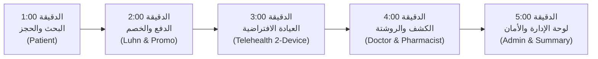

# دليل مناقشة مشروع MediCare وحقيبة العرض التقني (Defense Kit)

هذا الدليل أُعد خصيصاً لمناقشة مشروع التخرج والتقييم التقني أمام لجان التحكيم الأكاديمية والمهنية. يحتوي على خطة عرض حي موقوتة بالدقائق (5 دقائق)، الأسئلة الهندسية المتقدمة وإجاباتها الدقيقة من واقع الكود، وتحليل ملاحظات الفاحص الأكاديمي، ودليل الصمود التقني في حال تعطل الإنترنت أو انقطاع الخدمات الخارجية.

---

## 1. ملخص المعمارية والأرقام المعتمدة (System Baseline)

- **المنصة:** .NET 8 (C# 12) مع ASP.NET Core MVC و Entity Framework Core 8.
- **قاعدة البيانات:** Microsoft SQL Server مع 10 ترحيلات متسلسلة بدقة وبدون أي انحراف في المخطط (Zero Schema Drift).
- **جودة الكود والاستقرار (تاريخ الفحص: 16 أكتوبر 2026):**
  - **657 اختباراً آلياً ناجحاً بنسبة 100%** (0 Failed, 0 Skipped).
  - بناء الحل في وضع Release بـ **0 أخطاء و 0 تحذيرات** (`0 Errors, 0 Warnings`, زمن البناء ~8.3 ثانية).
- **توضيح عدد الاختبارات للجنة:**
  - عدد دوال الاختبارات في الكود المصدري: **548 دالة اختبار** (تتكون من 516 دالة `[Fact]` + 32 دالة `[Theory]`).
  - دوال الـ `[Theory]` تتضمن 141 صف بيانات بارامتري (`[InlineData]` / `[MemberData]`)، مما يوسع حالات التنفيذ الإجمالية بدقة إلى **657 حالة اختبار منفذة وناجحة**.
- **المعمارية:** Clean Architecture / Modular Monolith:
  - `MediCare.Web`: واجهات المستخدم، التحكم، الحماية، والأمان.
  - `MediCare.Services`: قواعد العمل، منطق الحجز، التحقق، والتكاملات السحابية.
  - `MediCare.Data`: الكيانات، مستودعات البيانات، إدارة الأقفال والتزامن، والترحيلات.
  - `MediCare.Tests`: اختبارات الوحدة، التكامل، الأمان، والتزامن.

---

## 2. جدول الحسابات التجريبية الجاهزة للعرض (Demo Accounts)

> [!IMPORTANT]
> جميع كلمات المرور للحسابات التجريبية تُقرأ محلياً من `Seed:DefaultPassword` / `SEED_DEFAULT_PASSWORD` عبر `user-secrets` أو متغيرات البيئة، ولا تُحفظ في الـ Git نهائياً.

| الدور (Role) | البريد الإلكتروني | الاسم الكامل | الغرض في العرض الحي |
| :--- | :--- | :--- | :--- |
| **Admin** | `admin@medicare.com` | System Administrator | لوحة التحكم، الإحصائيات المجمعة في SQL، مراجعة واعتماد الأطباء. |
| **Doctor** | `ahmed.mahmoud@medicare.com` | Dr. Ahmed Mahmoud (Cardiology) | جدول المواعيد، الكشف السريري، كتابة الروشتة، دخول Telehealth. |
| **Patient** | `khaled.omar@medicare.com` | Khaled Omar | البحث، حجز السلوت، الدفع التجريبي، واستعراض الروشتة بالـ QR. |
| **Pharmacist** | `pharmacist@medicare.com` | Licensed Pharmacist | مسح وصرف الروشتات الإلكترونية وتوثيق الصرف. |

---

## 3. سيناريو العرض الحي في 5 دقائق (5-Minute Live Demo Script)

خطة زمنية منضبطة بالثواني تغطي دورة حياة المريض والطبيب كاملة:



### [00:00 - 01:00] الدقيقة الأولى: البحث وحجز الموعد
- **الشاشة:** دليل الأطباء `/Doctors`.
- **الحساب المستخدم:** `khaled.omar@medicare.com` (Patient).
- **الإجراء:**
  1. استعرض الفلاتر: تصفية بالتخصص (Cardiology)، والمحافظة (Cairo / الجيزة).
  2. افتح ملف الدكتور أحمد محمود، واعرض تقويم المواعيد التفاعلي (FullCalendar).
  3. اختر موعداً متاحاً في اليوم التالي (مثلاً الساعة 10:00 صباحاً).
  4. اضغط "احجز الآن" لتنتقل لصفحة مراجعة الحجز وتأكيد الأعراض.

### [01:00 - 02:00] الدقيقة الثانية: الدفع التجريبي وكود الخصم
- **الشاشة:** صفحة الدفع `/Appointments/Checkout/{id}`.
- **الإجراء:**
  1. بيّن للجنة أن الدفع محاكاة إلكترونية (`Simulated Card Checkout`) تعتمد على التحقق من خوارزمية Luhn وتاريخ الصلاحية دون وسيط بنكي خارجي.
  2. أدخل كود الخصم الترويجي `DEPI2026` واضغط "تطبيق الخصم" لتوضح الخصم المباشر (100%).
  3. أدخل بطاقة اختبارية (مثلاً تبدأ بـ `4111 1111 1111 1111`) واضغط "إتمام الدفع التجريبي".
  4. استعرض إيصال السداد الفوري وتغير حالة الموعد إلى `Confirmed` و `Paid`.

### [02:00 - 03:00] الدقيقة الثالثة: العيادة الافتراضية (Telehealth)
- **الشاشة:** غرفة الكشف المرئي `/Appointments/Telehealth/{id}`.
- **الإجراء:**
  1. ادخل الغرفة واشرح للجنة أن الغرفة تعتمد على WebRTC عبر خدمة Jitsi Meet كنموذج عرض تعليمي (`Educational Demo`).
  2. بيّن أن رابط الغرفة مشفر بمفتاح عشوائي غير قابل للتخمين (32-hex token).
  3. اضغط على زر **"Join Live Video Room"** لتشغيل الفيديو الحي، أو اعرض المعاينة المحلية من خلال **"Enable Local Camera Preview"**.
  4. استعرض مسودة الملاحظات السريرية وأكد للجنة أنها **محفوظة في الذاكرة المؤقتة (In-Memory)** فقط ولا تُخزن في `localStorage` حمايةً لخصوصية المريض على الأجهزة المشتركة.

### [03:00 - 04:00] الدقيقة الرابعة: التوثيق الطبي وصرف الروشتة بالـ QR
- **الشاشة:** تسجيل الكشف السريري للـ Doctor ثم بوابة الصيدلي `/Prescriptions/Verify`.
- **الإجراء:**
  1. بدخول حساب الطبيب: قم بتوثيق التشخيص والأعراض وكتابة الروشتة ببنود علاجية محددة.
  2. افتح صفحة طباعة الروشتة `/Prescriptions/Print/{id}` واعرض الـ QR Code المولد ذاتياً من السيرفر.
  3. بدخول حساب الصيدلي (`pharmacist@medicare.com`): قم بفحص الرمز وصرف الروشتة واشرح حماية التزامن الذري لمنع الصرف المزدوج (`[ConcurrencyCheck] IsDispensed`).

### [04:00 - 05:00] الدقيقة الخامسة: لوحة الإدارة وهندسة الأمان
- **الشاشة:** لوحة تحكم الأدمن `/Admin`.
- **الإجراء:**
  1. استعرض المؤشرات الحية: المواعيد المكتملة، الإيرادات المجمعة في استعلام SQL Server واحد، وتوزيع التخصصات.
  2. استعرض قائمة الأطباء قيد المراجعة واعتماد طبيب جديد.
  3. اختم بالملخص الهندسي: منع التضارب عبر الفهرس المفلتر الفريد، تفعيل قفل الحساب للأدمن، ونجاح 657 اختباراً آلياً بنسبة 100%.

---

## 4. بنك الأسئلة الهندسية وتحليل ملاحظات الفاحص الأكاديمي

هذا القسم يجيب بدقة وشفافية عن الملاحظات السبع الأساسية التي وردت في تقرير الفاحص الأكاديمي:

### س1: لماذا يطبق التطبيق migrations تلقائياً عند بدء التشغيل وهل هذا مناسب للإنتاج؟
> **الإجابة الهندسية:**
> - في التطوير والعرض المحلي (`Development`)، يتم تطبيق الترحيلات تلقائياً (`DbInitializer.cs`) لتسهيل تجربة المطور وتشغيل الـ Demo فوراً دون خطوات يدوية.
> - **أما في بيئة الإنتاج (`Production`):** تم تقييد ذلك برمجياً، فالتطبيق **يعطل الترحيل التلقائي عند بدء التشغيل** افتراضياً (`applyMigrationsOnStartup = isDevelopment || config.ApplyMigrationsOnStartup`).
> - السبب الهندسي: منع حدوث Race Conditions وتضارب الأقفال (Table Locks) عند تشغيل عدة حاويات (Multi-instance containers) في نفس الوقت، وضمان تطبيق الترحيلات عبر Pipeline سحابي مخصص (CI/CD) مسبوق بنسخ احتياطي (Backup).

### س2: لماذا عُطل قفل الحساب (Lockout) للأدمن سابقاً وكيف تم تصحيحه لتعزيز الأمان؟
> **الإجابة الهندسية:**
> - كان التفكير السابق هو منع هجمات حجب الخدمة (DoS) التي قد يقفل فيها مهاجم مجهول حساب الأدمن الوحيد بتجربة 5 كلمات مرور خاطئة.
> - لكن الفاحص الأكاديمي أشار بحق إلى أن ذلك يُضعف الحماية ضد هجمات التخمين الموزعة (Distributed Brute-force).
> - **التصحيح المعتمد في الكود:** تم تفعيل قفل الحساب للأدمن رسمياً (`LockoutEnabled = true`) في كافة البيئات (قفل 15 دقيقة بعد 5 محاولات فاشلة).
> - **طبقات الحماية المضافة (Defense-in-Depth):**
>   1. محدد معدل الطلبات حسب الـ IP لمنع الإغراق (`IP Rate Limiting: 5 req/min`).
>   2. تسجيل تحذيرات أمنية عالية الخطورة مع كل محاولة فاشلة.
>   3. توفير أداة استرداد سريعة للأدمن عبر سطر الأوامر على السيرفر مباشرة دون الحاجة لفتح قاعدة البيانات:
>      `dotnet run --project src/MediCare.Web -- --recovery-unlock-user admin@medicare.com`
>   4. في بيئة التطوير فقط، يقوم الـ Seeder بمسح العدادات تلقائياً لتسهيل تجارب المطور.

### س3: كيف حميت خصوصية الملاحظات السريرية في صفحة Telehealth بعد ملاحظة الـ localStorage؟
> **الإجابة الهندسية:**
> - لاحظ الفاحص تخزين الملاحظات في `localStorage` مما قد يُبقي بيانات المريض على الأجهزة المشتركة بعد تسجيل الخروج.
> - **التصحيح المنفذ:** تم حذف التخزين في `localStorage` بالكامل، وأصبحت مسودة الملاحظات محفوظة فقط في ذاكرة المتصفح المؤقتة (In-Memory DOM State) طوال فترة الجلسة وتتلاشى فور مغادرتها.
> - كما تم وضع تنبيه قانوني واضح في الواجهة بأن هذه المسودة لا تُعتبر سجلاً طبياً، وأن التوثيق السريري الرسمي يتم حصراً عبر نموذج الكشف الطبي المعتمد (`Medical Encounter`).

### س4: هل غرفة الكشف الافتراضي (Telehealth) معتمدة سريرياً (HIPAA-Certified)؟
> **الإجابة الهندسية:**
> - تم توضيح وتوصيف الميزة صراحة في الكود والواجهة كـ **نموذج عرض تعليمي (Educational Demonstration)**.
> - النظام يستند إلى خادم WebRTC المفتوح (Jitsi Meet). يتم حماية الغرفة داخل MediCare عبر:
>   1. توليد مفتاح مشفر عشوائي غير قابل للتخمين (32-Hex Cryptographic Secret).
>   2. التحقق من صلاحيات المريض والطبيب والنافذة الزمنية قبل إعطاء المفتاح.
> - ومع ذلك، نعترف بوضوح للجنة بأنه في بيئة الإنتاج السريرية الفعلية، يجب الاعتماد على خادم WebRTC داخلي معزول (On-premise Private WebRTC) أو مزود معتمد يدعم توثيق هوية المشتركين (Participant Identity Federation).

### س5: كيف تمنع تكرار إرسال التذكيرات (Appointment Reminders) عند فشل النظام؟
> **الإجابة الهندسية:**
> - في `AppointmentReminderService.cs`، تم تعديل التدفق ليقوم بحفظ حالة الموعد وتثبيتها ذرياً (`appt.ReminderSent = true; await _uow.CommitAsync();`) مباشرة فور إرسال إشعارات كل موعد على حدة.
> - هذا يضمن أنه في حال حدوث خطأ أو انقطاع في الشبكة أثناء معالجة موعد لاحق، فإن المواعيد التي تم إشعارها مسبقاً مسجلة ومحفوظة، ولن تتم إعادة إرسال التذكير إليها عند إعادة تشغيل الخدمة الخلفية.

### س6: من أين جاء رقم 657 اختباراً وما الفرق بين عدد الـ Methods وحالات الاختبار المنفذة؟
> **الإجابة الهندسية:**
> - عدد الدوال المكتوبة في الكود المصدري بملفات `tests/MediCare.Tests` هو **548 دالة**:
>   - **516 دالة** `[Fact]` فردية.
>   - **32 دالة** `[Theory]` بارامترية.
> - دوال الـ `[Theory]` تحتوي على 141 صف مدخلات (`[InlineData]` و `[MemberData]`) لاختبار سيناريوهات وحالات حدية متعددة لنفس الدالة (مثل التحقق من صحة البطاقات، تنسيق الهواتف، وفترات المواعيد).
> - محرك xUnit ينفذ كل صف كحالة اختبار مستقلة، مما يعطي إجمالي:
>   $$516 + 141 = 657 \text{ حالة اختبار منفذة وناجحة بنسبة 100%}$$
> - هذا موثق ومطابق بدقة لخرج أمر: `dotnet test MediCare.sln -c Release --no-build`.

### س7: هل الدفع وبوابة الـ SMS خدمات مالية حقيقية أم محاكاة؟
> **الإجابة الهندسية:**
> - نوضح بشفافية كاملة أن الدفع هو **Simulated Card Checkout**: يتحقق من خوارزمية Luhn وتاريخ الانتهاء والأكواد الترويجية، ويولد رقم عملية تجريبي، ولا يرسل أموالاً فعلية لبنك.
> - خدمة الـ SMS موصوفة كـ `MockSmsService` تسجل في السجلات دون تكلفة رصيد.
> - خدمة البريد تدعم كلاً من SendGrid الحقيقي (100 إيميل/يوم مجاناً) أو المحاكاة المحلية عند غياب المفتاح.

---

## 5. خطة الصمود والطوارئ أثناء العرض (Presentation Resilience)

إذا حدث أي طارئ تقني أثناء المناقشة أمام اللجنة، اتبع هذه البدائل الفورية:

| المشكلة المحتملة | سببها المحتمل | الإجراء البديل الفوري (Fallback) |
| :--- | :--- | :--- |
| **انقطاع الإنترنت في القاعة** | شبكة القاعة تعطلت | الموقع يعمل محلياً بالكامل على `localhost:5000` أو `LocalDB` دون حاجة لإنترنت. |
| **تعطل كاميرا أو مايك اللابتوب في Telehealth** | إذن المتصفح غير مفعل | اضغط على زر **"Local camera preview"** داخل الغرفة لعرض المعاينة، أو افتح الموقع من الموبايل المتصل بنفس الشبكة. |
| **فشل مسح الـ QR من الموبايل** | الموبايل غير متصل بنفس الشبكة | انسخ رابط التحقق وافتحه في تبويب متصفح منفصل لعرض شاشة التحقق الرسمية للملأ. |
| **نسيان كلمة مرور أحد الحسابات** | خطأ إملائي أثناء الكتابة | جميع الحسابات التجريبية تشترك في كلمة المرور الموحدة المحددة في `SEED_DEFAULT_PASSWORD` (مثل `Demo@Pass123!`). |

---

## 6. أوامر التشغيل السريع محلياً (Run Commands)

### للتشغيل المباشر عبر .NET CLI:
```powershell
# 1. الانتقال للمشروع
cd C:\Users\Mohamed\.gemini\antigravity\scratch\MediCare-docs

# 2. تشغيل الموقع مع تعيين كلمة مرور البذور
$env:ASPNETCORE_ENVIRONMENT="Development"
$env:SEED_DEFAULT_PASSWORD="Demo@Pass123!"
$env:PUBLIC_BASE_URL="http://localhost:5000"

dotnet run --project src/MediCare.Web
```

### للتشغيل عبر Docker (على أي جهاز يدعم Docker):
```bash
# تشغيل الموقع مع قاعدة بيانات SQL Server بحاوية متكاملة
docker-compose up -d
```
الموقع سيفتح مباشرة على: `http://localhost:5000`
